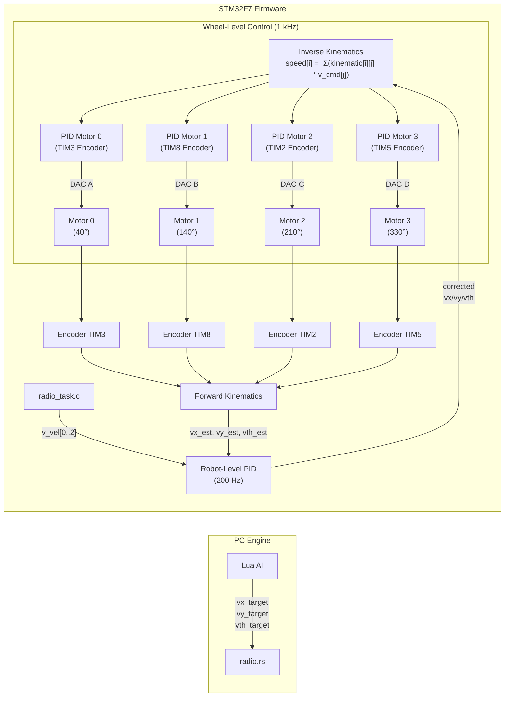
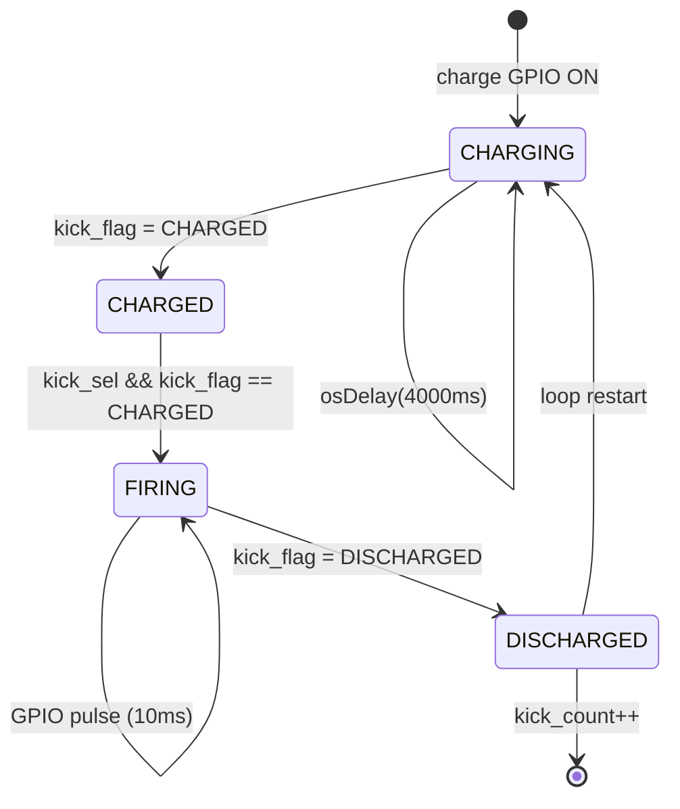

# Diagrama de Ciclo de Control del Robot

## Control en Cascada: Robot PID + Wheel PID



## Diagrama de Estados del Kicker



## Configuraciones PID

| Controlador | Kp | Ki | Kd | Rango Salida | Integral Max |
|---|---|---|---|---|---|
| Wheel PID | 25.0 | 44.0 | 0.0 | ±4095 | 4095 |
| Robot Vx PID | 0.8 | 1.6 | 0.0 | ±1.5 | 0.5 |
| Robot Vy PID | 0.8 | 1.6 | 0.0 | ±1.5 | 0.5 |
| Robot Vth PID | 5.0 | 2.0 | 0.0 | ±5.0 | 2.0 |

## Filtro de Odometría

- Low-pass filter en encoder: `y += alpha * (x - y)` con alpha = 0.15
- Feed-forward voltage: 300
- Congelamiento de integral cuando |comando| < 0.01
- Radio watchdog: 500ms timeout → coast motors + disable PID

## Fusión Sensorial (Kalman)

| Filtro | Estado estimado | Entradas | Q | R |
|---|---|---|---|---|
| KalmanVelocity1D (vx) | Velocidad lineal X | aceleración (ax_ms2) + encoder (vx_enc) | 0.2 | 0.05 |
| KalmanVelocity1D (vy) | Velocidad lineal Y | aceleración (ay_ms2) + encoder (vy_enc) | 0.2 | 0.05 |
| KalmanAngular2D (vth) | Vel angular + bias giro | giroscopio (gyro_z_rads) + encoder (vth_enc) | Qw=1.0, Qb=0.001 | 0.5 |

## Matriz Cinemática

Ángulos de ruedas: 60°, 130°, 230°, 300° (radio de rueda: 0.02704m, radio del robot: 0.08215m)

**Inversa** (en `kinematic[4][3]` en firmware):
```
speed[i] = kinematic[i][0]*vx + kinematic[i][1]*vy + kinematic[i][2]*vth
```

**Directa** (en `odometry.h`, precomputada como pseudoinversa):
```
vx_est = WHEEL_RADIO * (FK_00*w0 + FK_01*w1 + FK_02*w2 + FK_03*w3)
vy_est = WHEEL_RADIO * (FK_10*w0 + FK_11*w1 + FK_12*w2 + FK_13*w3)
vth_est = WHEEL_RADIO * (FK_20*w0 + FK_21*w1 + FK_22*w2 + FK_23*w3)
```
