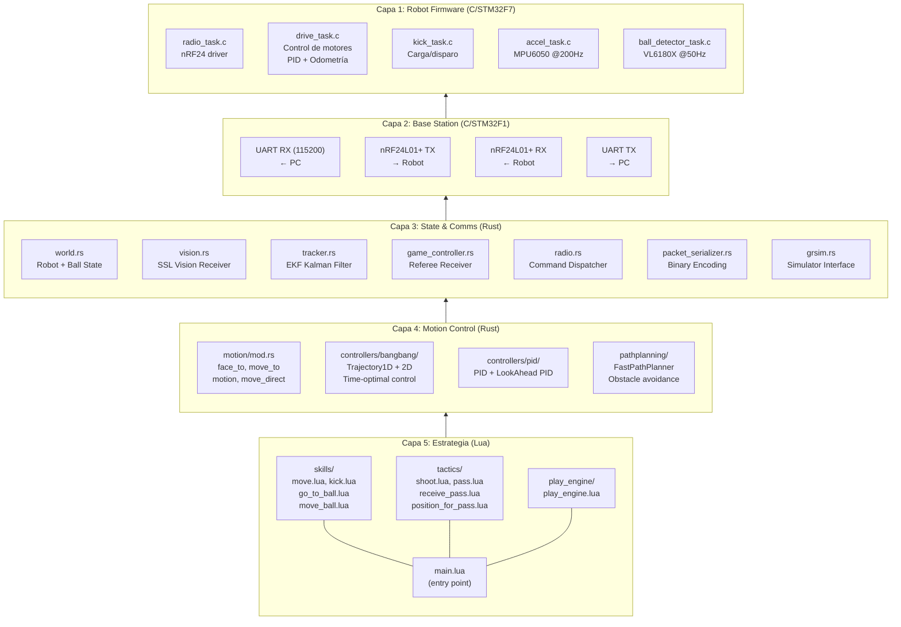
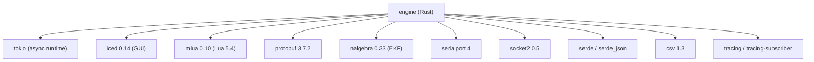

# Diagrama de Stack de Software

## Capas de Software

## Dependencias de Librerías (Rust Engine)

## Tareas FreeRTOS (Robot Firmware)

| Tarea | Prioridad | Stack (bytes) | Frecuencia | Propósito |
|---|---|---|---|---|
| `driveTask` | AboveNormal | 1024 | 1kHz wheel / 200Hz robot | Control de motores, PID, odometría, EKF |
| `accelTask` | Normal | 2048 | 200 Hz (5ms) | Lectura MPU6050 (acelerómetro + giroscopio) |
| `radioTask` | Normal | 2048 | Por evento | Comunicación nRF24L01+, telemetría |
| `kickTask` | Low | 2048 | 4s carga + disparo | Control del kicker |
| `ballDetectorTask` | Low | 128 | 50 Hz (comentada) | Sensor VL6180X ToF |
