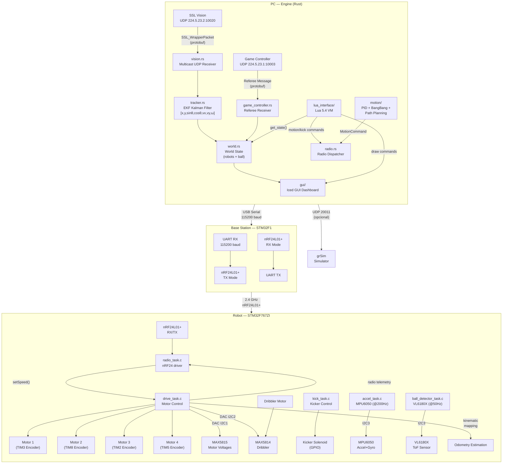

# Diagrama de Arquitectura del Sistema

## Flujo de Datos

1. **SSL Vision** envía posiciones de robots/pelota → `vision.rs` → `tracker.rs` (Kalman) → `world.rs`
2. **Game Controller** envía estado del partido → `game_controller.rs` → `world.rs`
3. **Lua AI** lee `world.rs`, ejecuta estrategia (skills/tactics), envía comandos → `radio.rs`
4. **Motion Control** (PID/BangBang) genera velocity commands → `radio.rs`
5. **Radio Dispatcher** serializa comandos → USB → Base Station → nRF24 → Robot
6. **Robot** ejecuta comandos: control PID de ruedas (1kHz), odometría, kicker, sensores
7. **Robot** envía telemetría (velocidades estimadas, ball possession) → nRF24 → Base Station → PC
